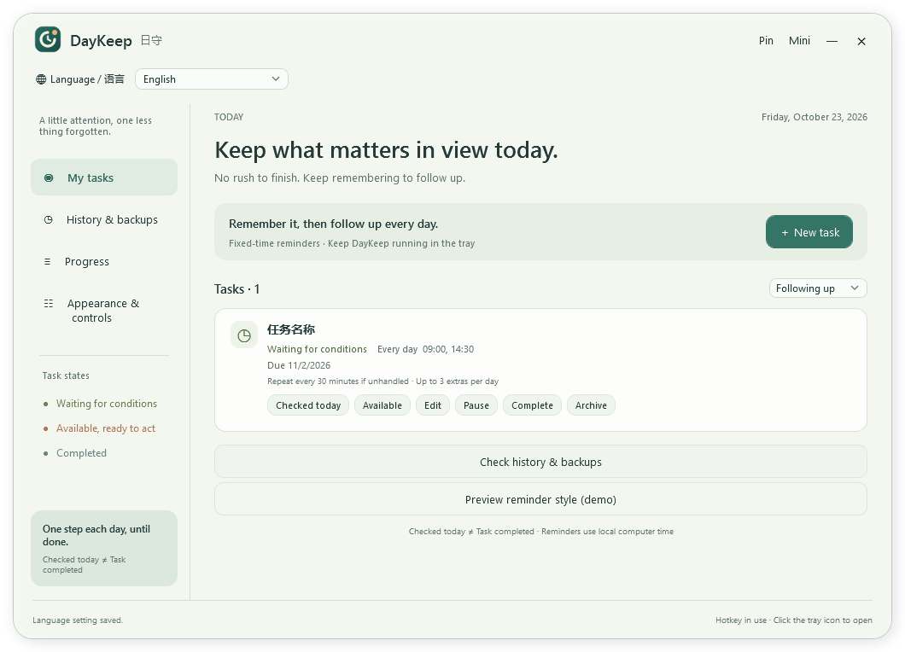
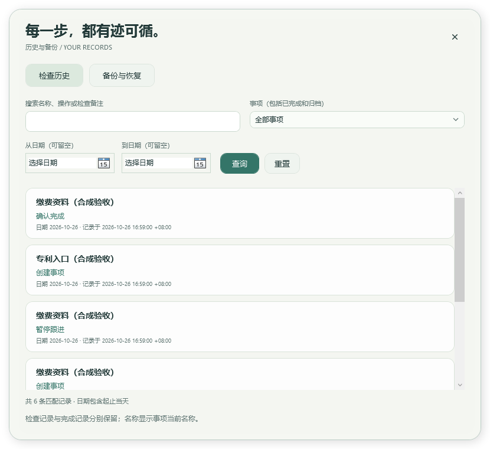

# DayKeep

[简体中文](README.md) · [繁體中文](README.zh-TW.md) · [English](README.en.md) · [日本語](README.ja.md) · [한국어](README.ko.md) · [Français](README.fr.md) · [Deutsch](README.de.md) · [Español](README.es.md) · [Português](README.pt.md)

[Download Windows ZIP](https://github.com/Thicky-han/DayKeep/releases/download/v0.7.0-beta.1/DayKeep-0.7.0-beta.1-win-x64.zip) · [Corresponding source](https://github.com/Thicky-han/DayKeep/releases/download/v0.7.0-beta.1/DayKeep-0.7.0-beta.1-source.zip) · [Checksums](https://github.com/Thicky-han/DayKeep/releases/download/v0.7.0-beta.1/SHA256SUMS) · [Release page](https://github.com/Thicky-han/DayKeep/releases/tag/v0.7.0-beta.1)

**One small step each day, until it is done.** A local Windows desktop reminder for tasks that need repeated checking, such as a patent payment portal that has not opened yet. Checking today and completing the whole task are separate actions.

Current public pre-release **0.7.0-beta.1** was approved for publication by the maintainer. It adds nine interface languages and a visible language selector, alongside history and backup/restore. The links above provide this version's binary, source and checksums; see the [language update report](LANGUAGE_UPDATE_REPORT.md) for build, packaging and publication-verification progress. Older **0.6.0-l6** has a Simplified Chinese-only UI; its original assets and tag remain unchanged. Frozen documents inside the approved package describe its candidate state at packaging time. Three days of real use remain pending. This build is unsigned.

## Change the interface language

Use **Language / 语言** at the top of the main window. The selector remains visible in both expanded and compact modes; no settings page is needed. Each option uses its own language name: **简体中文, 繁體中文, English, 日本語, 한국어, Français, Deutsch, Español, Português**.

The selection immediately updates application text in the main window, task forms, reminders, history and backup tools, and is saved locally for the next launch. First use and upgrades without a saved language default to Simplified Chinese. If saving fails, an error appears and the previous language remains; the app does not report a false success.

Your task names, notes, links and original records are not translated. Switching languages does not change the computer's local time zone, weekdays or scheduled times. Enter times as 24-hour `HH:mm` and deadlines as `yyyy-MM-dd`. Chinese button names below are reference labels; the app displays their equivalents in the selected language. [Language and persistence rules](docs/LANGUAGES.md)

## Install and open

1. Extract the entire DayKeep-0.7.0-beta.1-win-x64.zip. Run on Windows x64; the .NET runtime is included, no SDK needed. Do not run inside the ZIP or copy only the executable. The older 0.6.0-l6 ZIP installs similarly but has no language selector.
2. Portable use: open DayKeep.exe. Check the package source and SHA256SUMS first; Windows may show an unknown publisher.
3. Per-user installation: run Install.cmd. It installs to LocalApplicationData/Programs/DayKeep/0.7.0-beta.1 and creates DayKeep desktop/Start menu shortcuts, without administrator access. Its PowerShell execution-policy exception applies only to that process.
4. Before upgrading, export a backup, save forms, and use the old tray menu **退出日守** (Exit). The × button only hides. Versions use separate program folders; old folders are retained. A repeated install accepts only the same intact build. Unknown folders or shortcuts are preserved.
5. Installation does not enable login startup or stop another running version. The first run migrates the database transactionally to schema 5; L1–L4 cannot read the upgraded database.

No account, server, telemetry, portal scraping, stored passwords, or automatic payment. Clicking a link opens your default browser; the app does not infer what happened on that page.

## Create your first task

1. **＋ 新建任务** (New task): name it “Check patent payment portal”. Choose **等待条件** for a condition that is not ready, or **普通待办** for a task you can handle now.
2. Optionally add a full http/https URL and notes. URLs containing credentials are rejected. An unknown deadline may remain empty.
3. Enter `09:00`, or `09:00, 14:30`: 24-hour HH:mm, up to eight unique times. Select at least one weekday.
4. Defaults: repeat every 30 minutes if unhandled, at most three extra reminders per local day. The interval accepts 5–1440 minutes and the cap 0–24. Zero disables automatic extras, keeping fixed times.
5. Enter a known deadline as `yyyy-MM-dd`. Due-today and overdue tasks are highlighted and prioritized, never auto-completed. Save and keep the app in the tray.

## Follow the task each day

| Control (Chinese reference) | Meaning | What happens |
| --- | --- | --- |
| 打开平台 | Open portal | Opens the browser only; no check or completion is recorded |
| 今日已检查，尚未开放 | Checked today, still unavailable | Saves a check and suppresses today's waiting checks; the next selected day resumes |
| 已开放，转待办理 | Available, ready to handle | Records readiness and keeps following the task |
| 10 分钟后 / 30 分钟后 / 1 小时后 | Snooze 10 / 30 / 60 minutes | Postpones this task, overriding intervening fixed and extra slots; survives restart |
| 确认已完成 | Confirm completed | Stops reminders; completion can be undone |

Reminders merge tasks into one topmost, scrollable window without requesting keyboard focus or disappearing after a few seconds. Closing the reminder does not complete a task. Defaults after 09:00 are 09:30, 10:00 and 10:30; a collision with a fixed time is merged without extra budget. Explicit snooze does not spend that budget. A daily waiting check cancels that day's remaining waiting reminders.

**暂停** pauses without discarding state; resume follows future slots. **归档** archives without deletion; restore via the archived filter. **撤销完成** restores the original state and pause flag, even after restarting. A portal visit never counts as payment confirmation.

## Desktop controls and recovery

- **窄窗 / 展开**: compact/expanded window; **置顶**: pin. Appearance adjusts the background only, leaving text opaque.
- × or Esc hides to tray. Ctrl+Alt+D, tray click, or launching again brings it back. Use the tray if the hotkey is occupied. Hiding preserves an open form; closing the form discards its draft.
- Tray **退出日守** exits. A stopped app or powered-off PC cannot show reminders.
- On restart/resume/unlock, each task recovers only its latest eligible missed fixed slot. Pending/shown but undismissed deliveries recover; dismissed slots stay dismissed. Unavailable desktops and other full-screen apps defer display.
- **登录 Windows 后在托盘运行** enables login startup and defaults off. Windows may disable/delay startup. Recheck it after changing program directories. Exiting still stops the current session.

## Search history

Open **历史与备份**, or **检查历史与备份** at the bottom in compact mode. Choose a task, inclusive date range, and/or text from its name, action or check note; click **查询**. **重置** resets filters. Completed and archived tasks are included. The latest 200 matches are shown; narrow the range for older entries. Backups contain all records.

Checks and completion are distinct. Titles reflect the current task name. A check keeps its original local date; timestamps display in the current time zone.

## Back up, restore and undo an import

1. **备份与恢复 → 导出完整备份** exports to a new `.daykeep.json`. Existing files are never overwritten. Unsaved forms are excluded.
2. The plaintext backup includes tasks, events, checks, completion undo, archive, snooze, daily budgets and delivery records. Interface language, appearance and login startup are excluded; an import does not change your language. Store it privately and import only trusted files.
3. **选择备份并预览** previews counts and export time without changing data. **合并** imports only task GUIDs absent locally; existing same-ID task groups remain entirely local. Same names with different IDs remain separate.
4. **替换** restores the entire backup and removes local tasks absent from it. Review the impact, save/close task forms, tick confirmation, then import. Changing modes or interface language resets confirmation. A language change keeps the selected file, mode and frozen preview; review its impact in the new language before confirming again.
5. If local data changes after preview, including a delivery/dismissal, use **重新预览**. Before writing, the app creates a recovery backup under Recovery beside tasks.db and displays its path on success.
6. To undo an import, preview that recovery file and use replacement. A recovery-file failure prevents changes; SQL errors roll back. Corrupt, incompatible, invalid or checksum-mismatched files are rejected.

Limits: 64 MiB, 20,000 tasks and 200,000 total records. SHA-256 detects corruption; it is not authentication or encryption. Restored undismissed reminders may appear immediately. See [format contract](docs/BACKUP_FORMAT.md) (Chinese).

## Data, uninstall and troubleshooting

Data is stored in the current user's LocalApplicationData/DayKeep: tasks.db and ui-settings.json (interface language and appearance). Replacing the program folder leaves it intact. Before manual copying, exit and copy the whole data folder, including any sidecar files. A corrupt database is preserved: keep a complete copy, rename the original folder, reopen an empty database and import a trusted backup.

To uninstall an installed version, turn off login startup, save and exit from the tray, then run **Uninstall.cmd inside that installed version's folder**. It removes only its unchanged manifest-listed files and shortcuts pointing to it; private data and other versions remain. Extra/modified files stop removal. A portable folder does not need installation or this uninstaller.

- No popup: check the tray process, time/day, pause/archive/completion and today's check; leave full-screen mode. Reopening recovers eligible missed slots.
- Old version opens: save and exit its tray process before launching the new one.
- Save/import error: preserve files, check permissions/disk/locks, and refresh stale previews. Errors are shown, not reported as success.
- Three-day real use, physical multi-monitor/mixed DPI, actual sleep/lock and exclusive full-screen acceptance remain pending. L4's final real-minute observation was deferred by desktop availability; controlled tests do not prove these scenarios.

[Detailed Chinese guide](INSTALL.md) · [Trial checklist](docs/TRIAL_CHECKLIST.md) · [Privacy](PRIVACY.md) · [Security](SECURITY.md)

## Build and license

Use Windows, PowerShell 7 and the SDK pinned in global.json. Run scripts/bootstrap.ps1 if needed, then build.ps1, test-core.ps1, test-shell.ps1 and check.ps1 in scripts/, followed by `git diff --check`. Package with scripts/package-release.ps1 from a clean commit; it creates the binary ZIP, corresponding source ZIP and SHA256SUMS and checks extraction, install/reinstall/uninstall and packaged WPF actions. Real-clock delivery is separately observed with test-reminder-live.ps1. See the [L6 report](L6_REPORT.md) for hosted CI and public download verification.

Original code, docs and approved clock logo: **AGPL-3.0-only**. Distribute LICENSE and corresponding complete source. Third-party licenses remain under licenses/ in the binary package; see [dependencies](DEPENDENCIES.md) and [brand provenance](assets/brand/README.md). [L5 report](L5_REPORT.md) · [L6 report](L6_REPORT.md)
