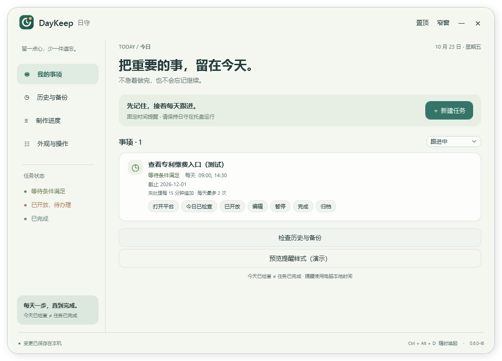

# DayKeep

[简体中文](README.md) · [繁體中文](README.zh-TW.md) · [English](README.en.md) · [日本語](README.ja.md) · [한국어](README.ko.md) · [Français](README.fr.md) · [Deutsch](README.de.md) · [Español](README.es.md) · [Português](README.pt.md)

[Télécharger Windows ZIP](https://github.com/Thicky-han/DayKeep/releases/download/v0.7.0-beta.1/DayKeep-0.7.0-beta.1-win-x64.zip) · [Code source](https://github.com/Thicky-han/DayKeep/releases/download/v0.7.0-beta.1/DayKeep-0.7.0-beta.1-source.zip) · [Empreintes](https://github.com/Thicky-han/DayKeep/releases/download/v0.7.0-beta.1/SHA256SUMS) · [Version publiée](https://github.com/Thicky-han/DayKeep/releases/tag/v0.7.0-beta.1)

Un petit pas chaque jour, jusqu'à la fin. DayKeep rappelle les démarches qui demandent des vérifications répétées, par exemple l'ouverture du paiement d'un brevet. Vérifier aujourd'hui ne termine pas la tâche. La préversion publique actuelle **0.7.0-beta.1**, dont la publication a été approuvée par le responsable, ajoute neuf langues d'interface et un sélecteur bien visible. Les liens ci-dessus fournissent cette version, ses sources et ses empreintes ; les résultats de compilation, de paquet et la progression des vérifications publiques figurent dans le [rapport de mise à jour linguistique](LANGUAGE_UPDATE_REPORT.md). L'ancienne **0.6.0-l6** n'a qu'une interface en chinois simplifié ; ses pièces jointes et son tag restent intacts. Les documents figés du paquet approuvé reflètent son état de candidat lors de l'emballage. L'essai réel de trois jours reste à valider. Binaire non signé.

## Changer la langue de l'interface

Ouvrez **Language / 语言** en haut de la fenêtre principale. Le sélecteur reste visible en mode large comme en mode compact, sans passer par les réglages. Chaque option porte son nom dans sa langue : **简体中文, 繁體中文, English, 日本語, 한국어, Français, Deutsch, Español, Português**.

Le choix actualise immédiatement les textes de l'application : fenêtre principale, formulaires, rappels, historique et sauvegardes. Il est enregistré localement et retrouvé au prochain lancement. Sans choix enregistré, y compris lors d'une mise à jour, la langue par défaut est le chinois simplifié. Un échec d'enregistrement affiche une erreur et conserve la langue précédente.

Vos noms de tâches, notes, liens et enregistrements d'origine ne sont pas traduits. La langue ne change ni le fuseau local du PC, ni les jours, ni les horaires. Utilisez toujours `HH:mm` sur 24 heures et `yyyy-MM-dd` pour les échéances. Les noms chinois ci-dessous servent de repères ; l'application affiche leur équivalent dans la langue choisie. [Langues et enregistrement](docs/LANGUAGES.md)

## Installation et mise à jour

Extrayez entièrement DayKeep-0.7.0-beta.1-win-x64.zip. L'ancien paquet 0.6.0-l6 s'utilise de même, mais sans sélecteur de langue. Windows x64, environnement .NET inclus, aucun SDK requis. Ne lancez pas depuis le ZIP et ne copiez pas seulement l'exécutable. Vérifiez la provenance et SHA256SUMS, puis ouvrez DayKeep.exe pour une utilisation portable. Windows peut afficher un éditeur inconnu.

Install.cmd installe sans droits administrateur dans LocalApplicationData/Programs/DayKeep/0.7.0-beta.1 et crée les raccourcis DayKeep du bureau/menu Démarrer. L'exception de stratégie PowerShell concerne ce processus uniquement. Le démarrage à la connexion reste désactivé. Avant une mise à jour : exportez une sauvegarde, enregistrez les formulaires et quittez l'ancienne version via「退出日守」dans la zone de notification ; × masque seulement. Les versions ont des dossiers distincts. Un dossier/raccourci inconnu est conservé ; une réinstallation identique exige les fichiers intacts. Au premier lancement, migration transactionnelle vers schema 5, illisible par L1–L4.

## Première tâche

1. 「＋ 新建任务」: saisissez « Vérifier le paiement du brevet ». Choisissez「等待条件」si vous attendez une ouverture,「普通待办」si vous pouvez déjà agir.
2. Ajoutez éventuellement une URL http/https complète et des notes. Les URL avec identifiants sont refusées ; laissez une échéance inconnue vide.
3. Horaire `09:00` ou `09:00, 14:30`, format 24 h HH:mm, huit horaires uniques maximum. Sélectionnez au moins un jour.
4. Par défaut : ajout toutes les 30 minutes sans traitement, trois rappels supplémentaires par jour local. Intervalle 5–1440 minutes, plafond 0–24. Zéro supprime les ajouts, pas les horaires fixes.
5. Échéance connue : `yyyy-MM-dd`. Aujourd'hui/en retard est mis en évidence, jamais terminé automatiquement. Enregistrez et gardez l'application dans la zone de notification.

## Suivi quotidien

| Bouton (repère chinois) | Utilisation |
| --- | --- |
| 打开平台 | Ouvrir le navigateur, sans enregistrer de vérification ni de fin |
| 今日已检查，尚未开放 | Vérifié, pas encore ouvert : arrête les vérifications du jour ; reprend au prochain jour choisi |
| 已开放，转待办理 | Ouvert : passe à la démarche à effectuer, poursuit le suivi |
| 10 分钟后 / 30 分钟后 / 1 小时后 | Reporter cette tâche de 10/30/60 minutes, remplace les créneaux intermédiaires et survit au redémarrage |
| 确认已完成 | Confirmer après réalisation ; arrête les rappels, annulation possible |

Les tâches simultanées sont regroupées dans une fenêtre au premier plan, défilante, sans demander le focus clavier ni disparaître après quelques secondes. Fermer ne termine rien. Après 09:00, les ajouts par défaut sont 09:30, 10:00, 10:30. Une collision avec un horaire fixe est regroupée sans supplément ; le report explicite ne consomme pas le plafond. La vérification quotidienne annule les rappels d'attente restants du jour.

「暂停」met en pause sans perdre l'état ;「归档」archive sans supprimer. Restaurez via les filtres.「撤销完成」rétablit l'état et la pause avant achèvement, même après redémarrage.

## Bureau et historique

「窄窗 / 展开」réduit/agrandit ;「置顶」épingle. Seul le fond devient transparent. ×/Esc masque ; Ctrl+Alt+D, clic sur l'icône ou relancement réaffiche. Utilisez l'icône si le raccourci est occupé. Masquer conserve le formulaire ; le fermer abandonne le brouillon.「退出日守」quitte vraiment. Un PC éteint ou une application arrêtée ne peut afficher de rappel.

Au redémarrage, réveil ou déverrouillage, seul le dernier créneau manqué admissible par tâche est regroupé. Les rappels non rangés reviennent, les créneaux rangés ne se répètent pas. Affichage différé sur bureau indisponible ou autre application en plein écran.「登录 Windows 后在托盘运行」est désactivé par défaut ; vérifiez-le après un changement de dossier. Windows peut retarder/désactiver ce démarrage.

Ouvrez「历史与备份」ou「检查历史与备份」en bas du mode compact. Choisissez une tâche, même terminée/archivée, des dates inclusives et du texte du nom/action/note ;「查询」recherche,「重置」réinitialise. Champs vides = sans limite. Les 200 résultats les plus récents sont visibles ; réduisez la plage pour les plus anciens. La sauvegarde garde tout. Nom actuel, date locale d'origine des vérifications, horodatage dans le fuseau actuel.

## Sauvegarder et restaurer

1. 「备份与恢复 → 导出完整备份」vers un nouveau `.daykeep.json`. Aucun écrasement ; formulaires non enregistrés exclus.
2. Contient tâches, historique, annulation de fin, archives, reports, budgets journaliers et distributions ; pas la langue, l'apparence ni le démarrage. L'import ne change pas la langue choisie. Fichier en clair : protégez-le, importez seulement une source fiable.
3. 「选择备份并预览」montre dates/comptages sans modifier.「合并」ajoute seulement les GUID absents ; pour le même ID, tout le groupe local reste. Même nom avec autre ID = autre tâche.
4. 「替换」restaure l'ensemble et retire les tâches locales absentes. Enregistrez/fermez les formulaires, vérifiez l'impact puis cochez la confirmation. Changer de mode ou de langue décoche. Le changement de langue conserve le fichier, le mode et l'aperçu figé ; vérifiez à nouveau l'impact dans la nouvelle langue avant de confirmer.
5. Si données ou distributions changent,「重新预览」. Avant modification, copie automatique des données actuelles dans Recovery à côté de tasks.db ; chemin affiché après succès.
6. Pour annuler l'import, prévisualisez cette copie et remplacez. Échec de copie : aucun changement ; erreur SQL : transaction annulée. Fichier corrompu, version/structure/empreinte incorrecte : refus.

Limites : 64 MiB, 20 000 tâches, 200 000 enregistrements au total. SHA-256 détecte des dommages, sans chiffrer ni authentifier. Des rappels restaurés non rangés peuvent apparaître immédiatement.[Contrat](docs/BACKUP_FORMAT.md).

## Données, désinstallation, dépannage

LocalApplicationData/DayKeep contient tasks.db et ui-settings.json. Remplacer le programme ne supprime pas les données. Copie manuelle : quittez, copiez tout le dossier et ses fichiers annexes. Base corrompue : gardez une copie complète, renommez l'ancien dossier, ouvrez une base vide puis importez une sauvegarde fiable.

Désactivez le démarrage, enregistrez, quittez via l'icône puis lancez **Uninstall.cmd dans le dossier installé**. Seuls les fichiers intacts listés et ses propres raccourcis sont retirés ; données privées/autres versions restent. Des fichiers ajoutés/modifiés arrêtent la suppression. Pas de désinstallation nécessaire pour le portable.

Pas de rappel : contrôlez l'icône, l'heure/jour, pause/archive/fin, vérification du jour, et sortez du plein écran. Ancienne version : quittez-la vraiment. Erreur de sauvegarde/import : gardez les fichiers, vérifiez droits/espace/verrouillage et actualisez la prévisualisation.

Aucun compte, télémétrie, collecte web, mot de passe ni paiement automatique. Trois jours réels, veille/verrouillage réels, plusieurs écrans/DPI mixtes et plein écran exclusif restent à valider. La dernière observation réelle L4 a été différée par la disponibilité du bureau ; les simulations ne prouvent pas ces cas.

[Essai](docs/TRIAL_CHECKLIST.md) · [Guide chinois](INSTALL.md) · [Développement en anglais](README.en.md) · [Confidentialité](PRIVACY.md)

Code, documentation et logo approuvé : AGPL-3.0-only. Fournissez LICENSE et le code source complet correspondant. Licences tierces dans licenses du paquet.[Rapport L6](L6_REPORT.md)
