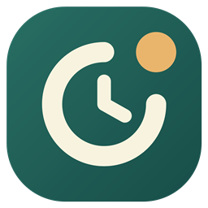

# DayKeep · 日守

[简体中文](README.md) · [繁體中文](README.zh-TW.md) · [English](README.en.md) · [日本語](README.ja.md) · [한국어](README.ko.md) · [Français](README.fr.md) · [Deutsch](README.de.md) · [Español](README.es.md) · [Português](README.pt.md)

**每天一步，直到完成。** DayKeep 是 Windows 本地桌面提醒器，适合“尚未开放，需要每天查看”的事项，例如专利缴费入口。固定时间弹出高亮提醒，未处理按间隔追加；今日检查与整件事完成分别记录。

当前候选版本 **0.6.0-l6**，包含历史查询和备份恢复。本文档提供九种语言，**应用界面目前为简体中文**。三天真实试用仍待验收；打包完成后由维护者确认公开发行，尚非签名正式安装包。

## 安装与首次打开

1. 将 DayKeep-0.6.0-l6-win-x64.zip **全部解压**到普通文件夹。不要在压缩包内运行，不要只拷贝 exe；Windows x64，自包含运行时，无需 .NET SDK。
2. 免安装：双击解压后的 DayKeep.exe。当前无代码签名；先核对来源与 SHA256SUMS，Windows 可能显示未知发布者。
3. 按用户安装：双击 Install.cmd，安装到当前用户 LocalApplicationData/Programs/DayKeep/0.6.0-l6，并建立 DayKeep 桌面/开始菜单入口，无需管理员。它调用随包 PowerShell 脚本，执行策略例外仅限该进程，不更改系统策略。
4. 安装不会启用登录启动，也不会自动关闭旧版本。升级前保存表单、从旧版托盘“退出日守”，导出可靠备份；× 只会收起。新版本首次运行会事务升级任务库，L1—L4 不能读取 schema 5。
5. 安装采用版本目录，旧版目录保留。相同版本重装只接受一致且完整的文件，未知或修改过的文件夹保留并提示。桌面已有不认识的快捷方式也保留。

离线运行不需要账号或服务器。程序只有在点击平台链接时交给默认浏览器打开网页，不读取网页、不保存密码、不自动缴费。

## 三分钟建立第一条提醒

1. 点击 **＋ 新建任务**，名称填“检查专利缴费入口”。选择“等待条件 · 先查看何时可以办理”；普通待办适合已经可以直接办理的事。
2. 链接可留空，填写时使用完整 http/https 地址；不要填带密码的链接。备注可写“先查看入口，开放后再缴费”。
3. 时间填 `09:00`，也可填 `09:00, 14:30`；24 小时格式，最多八个不同时间。选需要的星期，至少一天。
4. 默认未处理每 30 分钟追加，每本地日最多额外 3 次。间隔可设 5—1440 分钟，上限 0—24；0 关闭自动追加但保留固定提醒。
5. 截止日期未知就留空，已知填 `yyyy-MM-dd`。今天截止/逾期会高亮和提前排列；不会自动完成或隐藏。保存，保持日守在托盘运行。

## 每天怎样跟进专利

| 你看到或做的事 | 点击哪里 | 结果 |
| --- | --- | --- |
| 到点提醒 | 高亮窗口查看事项 | 多件合并，不主动抢键盘，不数秒后消失 |
| 要查看平台 | 打开平台 | 只开网页，不算检查或完成 |
| 今天尚未开放 | 今日已检查，尚未开放 | 保存检查，停止当天检查提醒；下个所选提醒日继续 |
| 发现可以缴费 | 已开放，转待办理 | 保存开放结果，继续保留并跟进办理 |
| 暂时忙 | 10 分钟后 / 30 分钟后 / 1 小时后 | 只延期该事项，覆盖期间固定/追加，重启后仍有效 |
| 缴费确实完成 | 确认已完成 | 停止提醒，进入已完成；从列表可撤销 |

关闭提醒仅收起本次，未完成事项仍会按规则追加。默认 09:00 后依次 09:30、10:00、10:30 追加；固定时间与追加撞点合并，不多扣次数。延期不消耗自动追加上限，当天检查会取消当天等待检查的剩余提醒。

暂停停止提醒但保留状态；恢复继续未来时刻。归档只收起事项，切到“已归档”可恢复。完成前的状态与暂停标志保留，“撤销完成”可在重启后恢复。系统不根据打开网页推断办理成功。

## 桌面操作与恢复提醒

- 窄窗/展开切换桌面宽度；置顶可开关；外观页只调整背景透明度，文字保持清晰。
- × 或 Esc 收起到托盘；Ctrl+Alt+D、托盘左键或再次启动唤回。快捷键冲突时用托盘。隐藏主窗也保留未保存表单，关闭表单则放弃草稿。
- 托盘右键“退出日守”才彻底结束；停止运行或关机期间不会显示提醒。
- 重启、休眠恢复、解锁后，每件只汇总最近有效的遗漏时刻，多天不会逐次轰炸；未收起投递恢复，已收起时刻不重复。不可用桌面或其他程序全屏时暂缓。
- 外观页“登录 Windows 后在托盘运行”默认关闭。开启后下次登录后台运行；退出仍会停止本次会话。移动/换版本目录后需在新版本重新核对启动开关，Windows 也可能禁用启动项。

## 查找历史

左栏 **历史与备份**，窄窗底部 **检查历史与备份**。选择事项（包括完成/归档）、起止日期，或搜索名称、操作、检查备注，然后点击“查询”。日期包含起止当天，留空不限制，“重置”清除筛选。显示最新 200 条，更多时缩小范围；完整记录仍在备份。

“今日已检查”与“确认完成”是不同记录。名称显示当前事项名称；检查日期保留原本地日期，记录时间按当前时区显示。

## 备份、恢复与撤回导入

1. 在“备份与恢复”点“导出完整备份”，保存为新 `.daykeep.json`。已有文件不覆盖；未保存表单不包含。
2. 备份含所有任务、检查、操作、完成撤销、归档、延期、日预算及投递。不含外观、登录启动或程序。文件为明文，妥善保管，仅导入可信来源。
3. 选择备份先预览时间、任务/检查数和本机数量。**合并**仅新增本机没有的 GUID，同 ID 整组保留本机记录；不同 ID 的同名事项不会合并。
4. **替换**恢复整份备份，会移除备份没有的本机事项。核对影响、先保存/关闭任务表单，再勾选确认导入；改模式重置确认。
5. 预览后任务或提醒投递发生变化，需“重新预览”。导入前自动在任务库同目录 Recovery 另存当前数据，成功后显示可复制路径。
6. 要撤回，选择这个自动恢复文件，预览后用“替换”导入。写恢复文件失败不会修改任务库；SQL 错误事务回滚。损坏、版本不匹配、重复属性、校验错误或超过限制的文件会拒绝。

备份上限 64 MiB / 20,000 任务 / 合计 200,000 记录。SHA-256 检测损坏，不认证来源或加密。恢复的旧延期/未收起投递可能立即汇总。完整规则见 [备份契约](docs/BACKUP_FORMAT.md)。

## 数据、更新、卸载与常见问题

任务在当前用户 LocalApplicationData/DayKeep/tasks.db，外观在 ui-settings.json；不随程序目录替换。更新前先导出并从托盘退出。手动备份应退出后复制整个数据目录，包含可能存在的附属文件。损坏库不自动清空；需保留完整原目录，改名后重开空库，再从可信备份恢复。

卸载某个已安装版本：先关闭登录启动、保存并从托盘退出，再运行**安装目录里的 Uninstall.cmd**。只移除该版本清单内且未改动的程序文件及指向它的入口，任务数据和其他版本保留；发现额外或修改文件时停止并保留。免安装目录直接保留所需数据后移除；不从用户数据目录执行卸载脚本。

- 没提醒：核对程序在托盘运行、时间/星期、是否暂停/归档/完成或今天已检查，并退出全屏；重开会汇总遗漏。
- 打开仍是旧版：× 不是退出；保存后从旧托盘退出再开新版本。
- 无法保存/导入：保留原文件，检查权限、磁盘与占用；预览过期就重看，错误不会伪装为成功。
- 真实睡眠/锁屏、多屏/混合 DPI、独占全屏及至少三天实际试用仍待对应实机验收；L4 最后一轮实际分钟观测因桌面门控未显示，详见报告。受控测试不等于长期保证。

[详细使用说明](INSTALL.md) · [三天试用清单](docs/TRIAL_CHECKLIST.md) · [隐私](PRIVACY.md) · [安全](SECURITY.md)

## 开发与许可

Windows、PowerShell 7、global.json 固定 SDK。`scripts/bootstrap.ps1` 安装本地工具；依次运行 `scripts/build.ps1`、`scripts/test-core.ps1`、`scripts/test-shell.ps1`、`scripts/check.ps1` 和 `git diff --check`。`scripts/package-release.ps1` 从干净提交生成成品 ZIP、对应源码 ZIP 和 SHA256SUMS，并验证解压、安装/重装/卸载及包内 WPF。真实时钟另用 `scripts/test-reminder-live.ps1`，不把模拟当实测。GitHub CI 尚未运行。

原创代码、文档和已认可的回环时钟 Logo：AGPL-3.0-only；第三方保留各自许可。分发时提供对应完整源码包及 LICENSE，包内 licenses 含 .NET 与 SQLite 材料。[依赖](DEPENDENCIES.md) · [品牌来源](assets/brand/README.md) · [L5 报告](L5_REPORT.md) · [L6 报告](L6_REPORT.md) · [计划](IMPLEMENTATION_PLAN.md)
